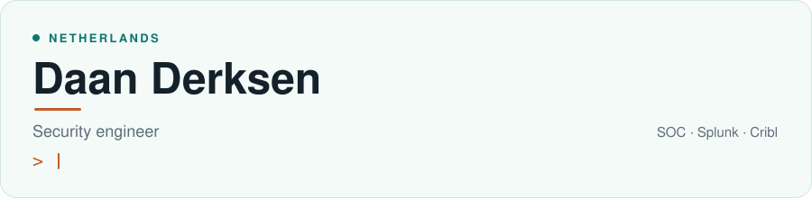
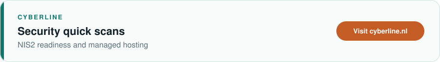
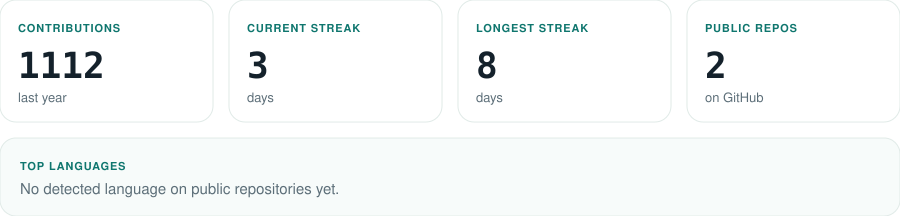

<!--
  Profile README for github.com/daan-11
  Header and Cyberline banner: .github/scripts/build_header.py
  Stats cards: .github/scripts/render_dashboard.py
  Snake refresh: .github/workflows/refresh-profile.yml
  KubeCare and Bastion are named without repository links.
  The workflow also publishes the snake to the output branch.
-->

  <picture>
    <source media="(prefers-color-scheme: dark)" srcset="./assets/header-dark.svg" />
    <source media="(prefers-color-scheme: light)" srcset="./assets/header-light.svg" />
    
  </picture>

Security engineer in a SOC, based in the Netherlands. I work on log management and Splunk: SPL, indexes, onboarding log sources such as PostgreSQL, alerting, and dashboards. I also build Cribl-based log pipelines.

  <a href="https://cyberline.nl">
    <picture>
      <source media="(prefers-color-scheme: dark)" srcset="./assets/cyberline-dark.svg" />
      <source media="(prefers-color-scheme: light)" srcset="./assets/cyberline-light.svg" />
      
    </picture>
  </a>

  <a href="https://cyberline.nl"><strong>Work with Cyberline</strong></a> 
  Security quick scans, NIS2 readiness, and managed hosting for businesses.

## At a glance

<table>
  <tr>
    <th align="left">Work</th>
    <th align="left">Building</th>
    <th align="left">Home lab</th>
  </tr>
  <tr>
    <td valign="top">Security engineer in a SOC. Log management in Splunk, and Cribl-based log pipelines.</td>
    <td valign="top">KubeCare and Bastion, two projects of my own.</td>
    <td valign="top">Kubernetes, Tailscale, self-hosted n8n, and a Glance dashboard.</td>
  </tr>
</table>

I use Cursor for automation and AI-assisted development.

  
  
  
  
  
  

  
<strong>Splunk and the log pipelines</strong>

   
  In the SOC I work in Splunk. That means SPL, indexes, and onboarding log sources such as PostgreSQL, then alerting and dashboards on top of those logs. Cribl-based pipelines move the logs to where they need to go.

  
<strong>Home lab</strong>

   
  The lab runs on Kubernetes and Tailscale. n8n is self-hosted and handles the automations. Glance is the dashboard I keep in front of it. Cursor is where the automation and AI-assisted development happens.

  
<strong>KubeCare and Bastion</strong>

   
  KubeCare and Bastion are projects I am building myself.

## On GitHub

  <picture>
    <source media="(prefers-color-scheme: dark)" srcset="./profile/dashboard-dark.svg" />
    <source media="(prefers-color-scheme: light)" srcset="./profile/dashboard-light.svg" />
    
  </picture>

<!-- stats:start -->

923 contributions in the last year. Current streak: 2 days. Longest streak: 8 days. Public repositories: 2. No detected language on public repositories yet.

<!-- stats:end -->

  <a href="https://github.com/daan-11">
    <picture>
      <source media="(prefers-color-scheme: dark)" srcset="./assets/github-contribution-grid-snake-dark.svg" />
      <source media="(prefers-color-scheme: light)" srcset="./assets/github-contribution-grid-snake.svg" />
      
    </picture>
  </a>

